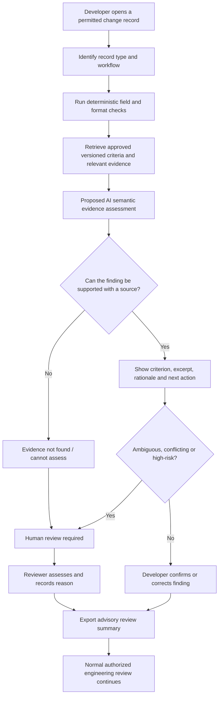

# Workflow and Proposed Screens

The prototype is a pre-review assistant, not an ASPICE audit or sign-off system. The diagram below shows the *target* AI-enabled workflow. The browser demo implements only the deterministic path, UI and disposition capture.

## Screen 1 - Review queue

Record identifier, risk level, findings by status and an unmistakable banner that this is advisory. The user should be able to select one item and inspect the evidence before taking any action.

## Screen 2 - Criterion detail

The screen shows the criterion and version, which data field or evidence fragment was used, whether it was a rules check or an AI interpretation, the assessment category, uncertainty, and a plain-language next action. An unavailable source must be marked unavailable rather than replaced with plausible text.

## Screen 3 - Human disposition and summary

The developer can correct, justify, or escalate a finding. Dispositions and reasons remain traceable. A reviewer keeps accountability for interpretation and approval.

## Browser prototype

A working synthetic, rules-based version can be opened at [`../../prototype/index.html`](../../prototype/index.html). A screenshot can be found in `../Screenshots_or_Video/` once captured and verified.
